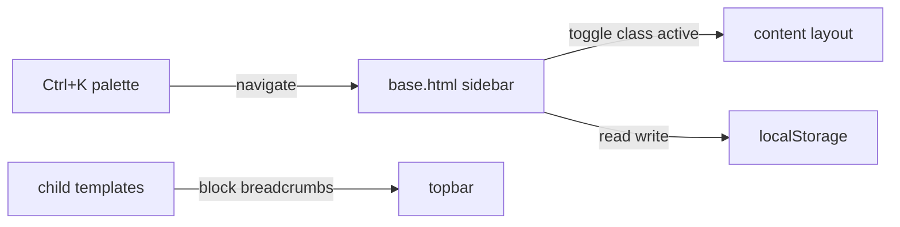

# Requirements

### Overview & Goals

Привести навигацию SBProduction (боковая панель и верхняя строка) к современному десктопному UX: свёртываемая панель, быстрый переход через Ctrl+K, хлебные крошки, корректная подсветка активного раздела. Адаптивность под телефоны и планшеты не делается: приложение работает только на десктопе.

### Scope

**In Scope**
- Свёртывание боковой панели до иконок с сохранением состояния.
- Командная палитра Ctrl+K для перехода по разделам и модулям.
- Хлебные крошки в верхней строке.
- Исправление подсветки активного пункта и ссылок в `templates/base.html`.
- Выравнивание версии Bootstrap JS с CSS.

**Out of Scope**
- Мобильная версия, offcanvas и адаптивные брейкпоинты (явно исключено пользователем).
- Поиск заказов по номеру через Ctrl+K: требует нового JSON-эндпоинта, это отдельная задача.
- Изменение функционала модалок, Select2 и tooltip-инициализации.
- Bootstrap 6: остаётся на 5.3.8.

### User Stories

- Как сотрудник цеха, я хочу свернуть панель до иконок, чтобы больше места занимали таблицы и формы заказа.
- Как пользователь, я хочу нажать Ctrl+K и быстро перейти в нужный раздел, не кликая по меню.
- Как пользователь, я хочу видеть, где я нахожусь, по хлебным крошкам и по подсвеченному пункту меню.

### Functional Requirements

- Кнопка `#sidebarCollapse` видна на десктопе (сейчас стоит класс `d-md-none`, то есть скрыта на широких экранах).
- В свёрнутом состоянии видны только иконки пунктов, подписи скрыты, у иконок есть tooltip с названием раздела.
- Состояние свёрнутости сохраняется в `localStorage` и восстанавливается при загрузке страницы без мигания.
- Ctrl+K (и Cmd+K) открывает палитру; поиск фильтрует список разделов по тексту; Enter переходит по выбранной ссылке; Esc закрывает.
- Подсветка активного пункта работает по `request.resolver_match.namespace` и `url_name`, а не по подстроке пути.
- Хлебные крошки отображаются в топбаре через новый блок ``, по умолчанию пусто.

### Non-Functional Requirements

- Визуальный стиль совпадает с `static/css/theme.css` (палитра `--sb-primary`, `--sb-accent`, радиусы `--sb-radius`).
- Никаких новых внешних библиотек: только Bootstrap 5.3.8 и Bootstrap Icons.

# Technical Design

### Current Implementation

- `templates/base.html` строки 37-137: `<nav id="sidebar">` с `ul.components`, пункты с `` (строка 106) и `'catalog/...' in request.path` (строки 110-120). Подсветка по подстроке ненадёжна.
- Строки 102-103 и 125: жёсткие `href="/"` и `href="/admin/"` вместо ``.
- Строки 105, 109, 123: `<div class="nav-section-title">` и строки 127-134: `<form>` внутри `<ul>` (невалидная вложенность HTML).
- Строки 143-155: топбар `nav.top-navbar` с кнопкой `#sidebarCollapse` (класс `d-md-none`) и блоком ``.
- Строки 181-190: JS переключает класс `active` на `#sidebar` и `#content`.
- Строки 196-290: глобальная инициализация tooltip (`initTooltips`) и Select2; их нельзя ломать.
- Строка 174: подключён `bootstrap.bundle.min.js@5.3.0`, а CSS (строка 12) уже `5.3.8`.
- Стили сайдбара лежат в `static/css/custom.css` и `static/css/theme.css`.

### Key Decisions

- **Свёртывание через класс на `#sidebar`**: переиспользуем существующий хук `#sidebarCollapse`, а не пишем новый. Состояние в `localStorage` под ключом `sb-sidebar-collapsed`.
- **Ctrl+K на чистом JS + Bootstrap modal**: без новых библиотек. Список разделов формируется из статического массива в шаблоне (через ``), фильтрация на клиенте.
- **Крошки как блок шаблона**: каждая страница задаёт свой ``, base.html не знает про модели.
- **Подсветка через `request.resolver_match`**: в шаблоне сравниваем `request.resolver_match.namespace` и `url_name`, для вложенных разделов (`catalog`, `orders`) проверяем namespace.

### Proposed Changes

- `templates/base.html`: исправить вложенность `<form>` и `<div>` (оборачивать в `<li>`), заменить жёсткие пути на ``, поменять логику `active`, убрать `d-md-none` с `#sidebarCollapse`, добавить `` в топбар, добавить блок палитры Ctrl+K и скрипт.
- `static/css/theme.css`: правила свёрнутой панели (ширина ~72px, скрытие `.nav-label`, центрирование иконок, плавная анимация `transition: width`). Существующий `#content.active` сохранить, но согласовать ширину.
- Пункты меню: подписи обернуть в `<span class="nav-label">` для скрытия в свёрнутом режиме.
- Версия JS: `bootstrap.bundle.min.js` на `5.3.8`.

### Data Models / Contracts

Новых моделей и API нет. Контракт шаблона:

```
   # в топбаре base.html
  # существующий, сохраняется
```

Ключи localStorage: `sb-sidebar-collapsed` (`"1"` или `"0"`).

### Architecture Diagram



### Risks

- Скрытие подписей в свёрнутом режиме может ломать `initTooltips`, если tooltip не получает `title`. Митигация: для свёрнутых пунктов tooltip берётся из `data-bs-title` (логика уже есть в `initTooltips`).
- Конфликт Ctrl+K с браузерной строкой поиска. Митигация: `preventDefault` только на перехвате внутри страницы.
- Select2 и модалки открываются поверх палитры. Митигация: палитра закрывается перед открытием другой модалки.
- Смена версии JS 5.3.0 -> 5.3.8 может повлиять на существующие модалки. Митигация: проверить открытие модалок на странице заказа и каталога вручную.

# Testing

### Validation Approach

- Статическая проверка: `.\.venv\Scripts\python.exe manage.py check` без ошибок.
- Проверка шаблонов: загрузка `base.html` и страниц через Django template loader без синтаксических ошибок.
- Ручная проверка в браузере по сценариям ниже.

### Key Scenarios

- Кнопка `#sidebarCollapse` на широком экране сворачивает панель до иконок, повторный клик разворачивает.
- После перезагрузки страницы состояние свёрнутости сохраняется.
- Ctrl+K открывает палитру, ввод «заказ» оставляет только пункт «Заказы», Enter ведёт на ``.
- На странице `order-list` подсвечен пункт «הזמנות», на `catalog:family-list` подсвечен пункт «משפחות», на дашборде подсвечен «לוח בקרה».
- На странице заказа крошки показывают путь «הזמנות > заказ».
- Модалки, сворачивание блоков (`data-bs-toggle="collapse"`) и Select2 в форме заказа работают как раньше.

### Edge Cases

- Пользователь не авторизован: sidebar не рендерится, палитра и кнопка не выводятся, JS не падает (проверка `if (sidebarCollapse)`).
- Пользователь без `is_staff`: пункт «פאנל ניהול» и Sync USB скрыты.
- Пустой запрос в палитре: показываются все разделы.
- Повреждённое значение в `localStorage`: трактуется как развёрнутая панель.

### Test Changes

- Автоматических тестов для шаблонов нет; новые тесты не добавляются, проверка выполняется статически и вручную.
- Существующие тесты в `apps/production/test_reports.py` не затрагиваются.

# Delivery Steps

###   Step 1: Fix sidebar markup and active-state logic in base.html
The sidebar renders valid HTML, all links use ``, and the active item is detected by route namespace.

- Move the `<div class="nav-section-title">` and `<form>` elements out of `<ul class="components">` into `<li>` wrappers (lines ~105, ~109, ~123, ~127-134).
- Replace `href="/"` (line ~103) with `` and `href="/admin/"` (lines ~83, ~125) with ``.
- Replace `'order' in request.path` and `'catalog/...' in request.path` checks with `request.resolver_match.namespace` and `url_name` comparisons.
- Verify with `manage.py check` and by loading `base.html` through the template loader.

###   Step 2: Add desktop collapsible icon-rail sidebar
The sidebar can be collapsed to icons on desktop and the state persists across reloads.

- Remove `d-md-none` from `#sidebarCollapse` in the topbar so the toggle is visible on desktop.
- Wrap each menu label in `<span class="nav-label">` and add `title`/`data-bs-title` for tooltips on collapsed items.
- Extend the existing DOMContentLoaded script: read and write `localStorage` key `sb-sidebar-collapsed`, apply the class before paint to avoid a flash.
- Add collapsed-state CSS in `static/css/theme.css` (width about 72px, hidden `.nav-label`, centered icons, width transition) and keep `#content.active` consistent with the new width.
- Keep the existing `#sidebar` and `#content` ids and the `active` class contract.

###   Step 3: Add Ctrl+K command palette
Ctrl+K (Cmd+K on macOS) opens a Bootstrap modal that filters and opens the main sections.

- Add a modal `#commandPalette` in `base.html` for authenticated users only, containing a search input and a list of links built with ``.
- Build the list from a static array in the template (dashboard, orders, families, series, models, customizers, admin for staff).
- Filter links on `input` by case-insensitive substring; Enter opens the first visible link; Esc closes the modal.
- Bind the keydown handler on `document` with `preventDefault` only when the palette is available.
- Order search by number is explicitly out of scope for this stage.

###   Step 4: Add breadcrumbs block and align Bootstrap JS version
Pages can show breadcrumbs in the topbar, and the Bootstrap JS matches the 5.3.8 CSS.

- Add `` to the topbar in `base.html` next to ``.
- Change the bundle script from `bootstrap@5.3.0` to `bootstrap@5.3.8` (line ~174).
- Add breadcrumbs (`nav` with `ol.breadcrumb`) to `templates/orders/order_detail.html` and `templates/catalog/model_list.html` as the first example pages; other pages stay unchanged.
- Manually verify that the order-form modals, collapse blocks and Select2 still open and close after the version change.