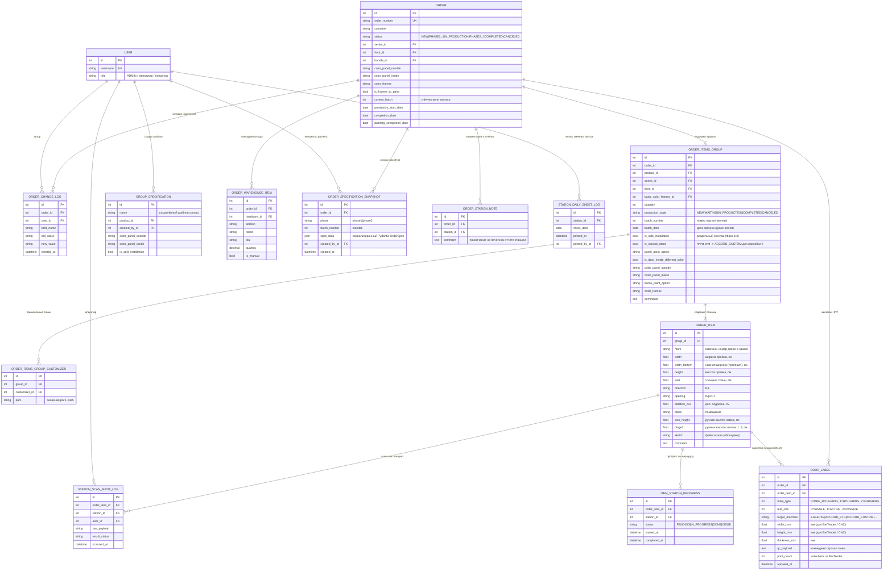

# Архитектура базы данных SBProduction

База данных разделена на 5 Django-приложений со строгим однонаправленным графом зависимостей (без циклических ссылок):

```text
accounts
catalog  <--  engineering  <--  orders  <--  production
```

* **`accounts`** — пользователи и роли доступа.
* **`catalog`** — коммерческий каталог (иерархия товаров, материалы, фурнитура, кастомизаторы).
* **`engineering`** — инженерные правила (JSON), спецификации материалов (`BOM`), стандарты высот, маршруты, станции, ЧПУ-макросы и SVG-пазлы.
* **`orders`** — коммерческие заказы, группы изделий, позиции (двери/коробки), сохранённые шаблоны и накладная склада.
* **`production`** — расчётные снимки спецификаций, наклейки ЧПУ (`BarTender`), трекинг прохождения станций и производственные журналы.

---

## 1. Ключевые инварианты данных

1. **Единицы измерения:**
   * В `orders`, `engineering` и `OrderSpecificationSnapshot` все геометрические размеры, зазоры, допуски, толщина деревянного канта и высоты фурнитуры хранятся **в положительных сантиметрах (см)**.
   * Отрицательные значения допускаются только для `lock_height` (отсчёт от низа полотна) и `double_leaf_overlap`.
   * В `catalog.Material` стандартные габариты листа/профиля (`thickness`, `length`, `width`) хранятся **в миллиметрах (мм)**.
   * В `production.DoorLabel` габариты для ЧПУ и BarTender переведены **в миллиметры (мм)** (единственная точка конвертации — `DoorLabelGenerator._cm_to_mm`).
2. **Расширяемость без миграций БД:**
   * Поля `ProductionStation.target_machine`, `ProductionStation.report_handler` и `Customizer.plugin_code` хранят строковые коды (`CharField` без жёстких `choices` на уровне БД). Допустимые значения подтягиваются динамически из реестров `MachineRegistry`, `ReportRegistry` и `CustomizerPluginRegistry`.
3. **Наследованные имена таблиц (`db_table`):**
   * При выделении `apps/engineering` часть таблиц сохранила исторические имена `production_*` (например, `production_bom`, `production_productionstation`), чтобы миграция прошла без переноса данных.

---

## 2. ER-диаграмма: Каталог и Инжиниринг (`catalog` + `engineering`)

```mermaid
erDiagram
    %% ===== CATALOG =====
    PRODUCT_TYPE {
        int id PK
        string code UK
        string name UK
        bool active
    }

    PRODUCT_FAMILY {
        int id PK
        int product_type_id FK
        string code UK
        string name
        bool has_door
        bool has_frame
        bool has_handle
        bool supports_split_installation
        float thickness "см"
        string allowed_direction "BOTH|IN_ONLY|OUT_ONLY"
    }

    SERIES {
        int id PK
        string code UK
        string name UK
        bool active
    }

    FRONT {
        int id PK
        int series_id FK
        string name
        string code
        string finish_type "PAINT|NO_PAINT|FORMICA"
    }

    PRODUCT_MODEL {
        int id PK
        string code UK
        string name
        int product_family_id FK
        int series_id FK
        int parent_model_id FK "наследование BOM и правил"
        bool active
    }

    COLOR {
        int id PK
        string name
        string code
        bool active
    }

    MATERIAL {
        int id PK
        string sku UK
        string name
        string common_name
        string material_type
        decimal thickness "мм"
        decimal length "мм"
        decimal width "мм"
        int color_id FK
        int outward_substitute_id FK "замена при OUT"
        decimal price_per_unit
    }

    MACHINING_FEATURE {
        int id PK
        string code UK
        string name
        string affects_role
    }

    HARDWARE {
        int id PK
        string sku UK
        string name
        string role "LOCK|CYLINDER|HANDLE|HINGE|OTHER"
        string common_name
        string rule_tag "правило расчёта склада"
        int color_id FK
        int machining_feature_id FK
        bool is_warehouse_item
        string par1_value "доп. параметры 1..3"
    }

    CUSTOMIZER {
        int id PK
        string code UK
        string name
        string tag "теги для отчётов и фильтров"
        string plugin_code "код плагина из CustomizerPluginRegistry"
        json bom_overrides "переопределение слотов BOM"
        int hardware_id FK
        int outward_replacement_id FK "автозамена при OUT"
        bool hidden_in_sales
        string par1_label "параметры par1..par5"
    }

    %% ===== ENGINEERING =====
    PRODUCT_ENGINEERING_RULE {
        int id PK
        int product_family_id FK "nullable"
        int product_model_id FK "nullable"
        json rules "зазоры, допуски, лимиты CNC, коэфф. раскроя (см)"
    }

    BOM {
        int id PK
        int product_id FK "OneToOne -> ProductModel"
        int covering_id FK "Material + Decimal consumption"
        int base_id FK "Material + Decimal consumption"
        int filling_id FK "Material + Decimal consumption"
        int panel_frame_id FK "Material + Decimal consumption"
        int casing_id FK "Material + Decimal consumption"
        int frame_id FK "Material + Decimal consumption"
        int lock_id FK "Hardware"
        int hinges_id FK "Hardware"
        int filling_preset_id FK "PuzzlePreset (4 слота)"
    }

    PRODUCTION_STATION {
        int id PK
        string code UK
        string name
        int order
        int specification_type "0=NONE, 1-3=LABELS, 10=REPORT"
        string report_handler "код из ReportRegistry"
        string target_machine "код из MachineRegistry"
        int alternative_station_id FK "перенос при перегрузе / габаритах"
        string template_name
        bool is_phase1
        bool active
    }

    PRODUCTION_ROUTE {
        int id PK
        string name
        bool active
    }

    PRODUCTION_ROUTE_STEP {
        int id PK
        int route_id FK
        int station_id FK
        int order
    }

    CUSTOMIZER_PRODUCTION_STATION {
        int id PK
        int customizer_id FK
        int station_id FK
        bool force_alternative_machine
    }

    LOCK_STANDARD_HEIGHT {
        int id PK
        float base_door_height "см"
        float base_lock_height "см"
        float step "см"
        float alignment_tolerance "см"
    }

    HINGE_STANDARD_HEIGHT {
        int id PK
        float min_height "см"
        float max_height "см"
        float value1 "value1..value5 (см)"
        int hinge_count
    }

    PUZZLE_PRESET {
        int id PK
        string name
        json blocks_config "геометрия SVG-блоков"
    }

    %% Связи Catalog
    PRODUCT_TYPE ||--o{ PRODUCT_FAMILY : "содержит"
    PRODUCT_FAMILY ||--o{ PRODUCT_MODEL : "определяет"
    SERIES ||--o{ FRONT : "имеет фасады"
    SERIES ||--o{ PRODUCT_MODEL : "определяет"
    PRODUCT_MODEL ||--o{ PRODUCT_MODEL : "parent_model"
    PRODUCT_MODEL }o--o{ CUSTOMIZER : "required_customizers"
    COLOR ||--o{ MATERIAL : "цвет"
    COLOR ||--o{ HARDWARE : "цвет"
    MATERIAL ||--o{ MATERIAL : "outward_substitute"
    MACHINING_FEATURE ||--o{ HARDWARE : "макрос обработки"
    HARDWARE ||--o{ CUSTOMIZER : "связанная фурнитура"
    CUSTOMIZER ||--o{ CUSTOMIZER : "outward_replacement"

    %% Связи Engineering
    PRODUCT_FAMILY ||--o| PRODUCT_ENGINEERING_RULE : "базовые правила"
    PRODUCT_MODEL ||--o| PRODUCT_ENGINEERING_RULE : "переопределения"
    PRODUCT_MODEL ||--o| BOM : "спецификация"
    MATERIAL ||--o{ BOM : "слоты материалов"
    HARDWARE ||--o{ BOM : "базовая фурнитура"
    PUZZLE_PRESET ||--o{ BOM : "SVG пресеты"
    PRODUCTION_ROUTE }o--o{ PRODUCT_MODEL : "маршруты модели"
    PRODUCTION_ROUTE ||--|{ PRODUCTION_ROUTE_STEP : "шаги"
    PRODUCTION_STATION ||--o{ PRODUCTION_ROUTE_STEP : "станция"
    PRODUCTION_STATION ||--o{ PRODUCTION_STATION : "alternative_station"
    CUSTOMIZER ||--o{ CUSTOMIZER_PRODUCTION_STATION : "правила маршрута"
    PRODUCTION_STATION ||--o{ CUSTOMIZER_PRODUCTION_STATION : "целевая станция"
    PRODUCT_FAMILY }o--o{ LOCK_STANDARD_HEIGHT : "стандарты замков"
    HARDWARE }o--o{ LOCK_STANDARD_HEIGHT : "замки"
    PRODUCT_FAMILY }o--o{ HINGE_STANDARD_HEIGHT : "стандарты петель"
    HARDWARE }o--o{ HINGE_STANDARD_HEIGHT : "петли"
```



---

## 3. ER-диаграмма: Заказы и Производство (`orders` + `production`)



---

## 4. Справочник таблиц по приложениям

### 4.1. `apps/catalog` (Коммерческий каталог)

| Модель | Таблица БД | Назначение и ключевые поля |
| :--- | :--- | :--- |
| `ProductType` | `catalog_producttype` | Верхний уровень каталога (двери, облицовки и т.д.). |
| `ProductFamily` | `catalog_productfamily` | Семейство конструкций (`has_door`, `has_frame`, `has_handle`, `supports_split_installation`, `allowed_direction`, `thickness` в см). |
| `Series` | `catalog_series` | Серия дизайна; свойство `available_frames` определяет доступные профили коробок. |
| `Front` | `catalog_front` | Фасад/отделка внутри серии (`finish_type`: `PAINT`, `NO_PAINT`, `FORMICA`). |
| `ProductModel` | `catalog_productmodel` | Уникальное пересечение `ProductFamily × Series`. Поддерживает наследование через `parent_model` и обязательные опции через `required_customizers` (M2M). |
| `Color` | `catalog_color` | Справочник базовых цветов материалов и фурнитуры. |
| `Material` | `catalog_material` | Листы, профили, кромки, коробки (`sku`, `common_name`, `thickness`/`length`/`width` в мм, `outward_substitute` для замены при открывании `OUT`). |
| `MachiningFeature` | `catalog_machiningfeature` | Инженерный признак обработки фурнитуры (связывает `Hardware` с нужным `HardwareMacroFile`). |
| `Hardware` | `catalog_hardware` | Фурнитура (`LOCK`, `CYLINDER`, `HANDLE`, `HINGE`, `OTHER`), комплекты (`components` M2M), правила расчёта склада (`rule_tag`, `par1..par3`), совместимость по области видимости (`product_types`/`families`/`models`). |
| `Customizer` | `customizers` | Настраиваемые опции и апгрейды. Содержит `tag` (фильтры отчётов), `plugin_code` (ссылка на модуль в `apps/production/engine/plugins/`), `bom_overrides` (JSON-подмена слотов BOM), `outward_replacement` и до 5 типизированных параметров `par1..par5`. |

---

### 4.2. `apps/engineering` (Инженерное ядро и справочники ЧПУ)

| Модель | Таблица БД | Назначение и ключевые поля |
| :--- | :--- | :--- |
| `ProductEngineeringRule` | `engineering_product_rules` | Единый источник геометрических правил (JSON, валидация `EngineeringRulesConfig`): зазоры полотна, вычеты коробки, припуск на пресс, коэффициенты раскроя, лимиты Essepigi. Слияние: `ProductFamily → parent_model → ProductModel`. |
| `BOM` | `production_bom` | Дерево материалов модели (`OneToOne → ProductModel`): 6 основных слотов (`covering`, `base`, `filling`, `panel_frame`, `casing`, `frame`), 3 профиля, 5 прочих материалов — у каждого расход в `DecimalField`, плюс базовая фурнитура (`lock`, `hinges`, `additional`) и 4 пресета SVG-пазла. |
| `LockStandardHeight` | `engineering_lockstandardheight` | Таблица расчёта стандартной высоты замка по высоте двери (`base_door_height`, `base_lock_height`, `step`, `alignment_tolerance` для выравнивания внутри батча). |
| `HingeStandardHeight` | `engineering_hingestandardheight` | Диапазоны высот двери (`min_height..max_height`) и координаты до 5 петель (`value1..value5`). |
| `ProductionStation` | `production_productionstation` | Справочник цеховых станций. Поля `target_machine` (из `MachineRegistry`) и `report_handler` (из `ReportRegistry`) связывают станцию с драйвером ЧПУ или модулем отчёта без правки кода; `alternative_station` задаёт запасной станок. |
| `CustomizerProductionStation` | `production_customizerproductionstation` | Влияние кастомизатора на маршрут: добавление доп. станции либо принудительный перевод на `alternative_station` (`force_alternative_machine=True`). |
| `ProductionRoute` / `ProductionRouteStep` | `production_productionroute` / `production_productionroutestep` | Упорядоченный базовый маршрут производства, привязанный к моделям (`products` M2M). |
| `PerimeterRoutingFile` | `engineering_perimeterroutingfile` | Программы периметрального раскроя по семействам дверей и признаку `edge_shape`. |
| `HardwareMacroFile` | `engineering_hardwaremacrofile` | ЧПУ-макросы врезки фурнитуры (`file_name`, `label_name`, `machining_feature`, привязка к `hardware` и `door_families`). |
| `CustomizerMacroFile` | `engineering_customizermacrofile` | ЧПУ-макросы, активируемые конкретным кастомизатором. |
| `FrontEngravingFile` | `engineering_frontengravingfile` | Файлы фрезеровки/гравировки фасадов (`Front`). |
| `SvgPattern` / `PuzzleBlockPrototype` / `PuzzlePreset` / `CustomizerPuzzleMapping` | `engineering_*` | Конструктор SVG-схем сэндвича полотна для печатного отчёта пресса. |

---

### 4.3. `apps/orders` (Заказы и позиции)

| Модель | Таблица БД | Назначение и ключевые поля |
| :--- | :--- | :--- |
| `Order` | `orders_order` | Паспорт заказа: номер, клиент, статус, общие настройки серии/фасада/ручки/цветов (`color_panel_outside`, `color_panel_inside`, `color_frames`), счётчик партий `current_batch`, плановые даты. |
| `OrderChangeLog` | `orders_orderchangelog` | Журнал аудита изменений статуса и полей заказа. |
| `OrderItemsGroup` | `orders_orderitemsgroup` | Группа однотипных дверей в заказе: модель, покраска, номер партии (`batch_number`), дата запуска (`batch_date`), состояние (`production_state`), флаг раздельного монтажа (`is_split_installation`) и флаг ручного ЧПУ-проекта **`is_special_detail` (`פרט מיוחד`)**. |
| `OrderItemsGroupCustomizer` | `orders_orderitemsgroupcustomizer` | Связь группы с выбранными `Customizer` и конкретными значениями `par1..par5`. |
| `OrderItem` | `orders_orderitem` | Конкретная дверь/коробка/облицовка: сквозной `mark`, размеры проёма в см (`width`, `width_bottom` для трапеций, `height`, `wall`), сторона и открывание (`direction`, `opening`), ручные высоты фурнитуры, эскиз (`sketch`). |
| `GroupSpecification` / `GroupSpecificationCustomizer` | `orders_groupspecification` / `orders_groupspecificationcustomizer` | Библиотека сохранённых шаблонов групп для быстрого повторного использования между заказами. |
| `OrderWarehouseItem` | `orders_orderwarehouseitem` | Строки складской накладной (автоматически рассчитываются через `WarehousePackingSlipService` + поддерживают ручные правки кладовщика). |

---

### 4.4. `apps/production` (Снимки, наклейки, трекинг)

| Модель | Таблица БД | Назначение и ключевые поля |
| :--- | :--- | :--- |
| `OrderSpecificationSnapshot` | `production_orderspecificationsnapshot` | Единственное хранилище рассчитанных JSON-спецификаций (`OrderSpec`) по `(order, phase, batch_number)`. Избавляет от повторного пересчёта при печати отчётов и работе склада. |
| `DoorLabel` | `production_doorlabel` | Таблица наклеек для интеграции с **BarTender**: по каждой позиции и створке (`leaf_role`) хранит операции `0` (`PRE_ROUGHING`), `1` (`ROUGHING`), `2` (`FINISHING`), целевой станок (`target_machine`), габариты в **мм**, готовый `qr_payload` и счётчик печатей `print_count`. При `group.is_special_detail=True` наклейка `2` получает `target_machine='ACCORD_CUSTOM'` и QR вида `C:\Ww8\PROJECTS\{order_number}\d{mark}.pgmx`. |
| `ItemStationProgress` | `production_itemstationprogress` | Текущий статус прохождения каждой позиции по каждой станции её маршрута (основа цехового трекинга и очередей). |
| `StationScanAuditLog` | `production_stationscanauditlog` | Полный журнал всех сканирований штрихкодов/QR на производственных терминалах. |
| `OrderStationNote` | `production_orderstationnote` | Индивидуальные комментарии диспетчера к конкретной станции в рамках заказа (выводятся в шапке печатного отчёта станции). |
| `StationDailySheetLog` | `production_stationdailysheetlog` | Журнал формирования ежедневных сменных листов станций. |

---

## 5. Ключевые JSON-структуры в БД

1. **`ProductEngineeringRule.rules`** (валидируется `apps/engineering/schemas.py → EngineeringRulesConfig`):
   * `frame_inner_width_reduction`, `frame_inner_height_reduction` — вычеты коробки (см);
   * `leaf_top_clearance`, `leaf_bottom_clearance`, `leaf_side_clearance`, `double_leaf_overlap` — зазоры полотна (см);
   * `press_allowance` — припуск заготовки на пресс (см);
   * `cnc_limits` — ограничения габаритов станка Essepigi (`max_width`, `max_height`, `min_width`, `min_height` в см);
   * `cut_coefficients` — коэффициенты раскроя листов.
2. **`Customizer.bom_overrides`**:
   * Словарь вида `{"filling": "SKU_OR_ID", "panel_frame": "SKU_OR_ID", "filling_preset": "ID_OR_NAME", "covering": ""}` для подмены или обнуления слотов `BOM` без написания Python-плагина.
3. **`OrderSpecificationSnapshot.spec_data`**:
   * Сериализованная Pydantic-модель `OrderSpec`: словарь `batches: { "<batch_num>": [ProductionSpec, ...] }`, содержащий рассчитанные габариты полотен (`panel_dimensions`), пресса (`press_dimensions`), раскроя, развёрнутый `bom_items` (с `sku`), высоты фурнитуры (на полотне и на коробке), `route_station_ids`, `cnc_targets`, `puzzle_spec` и `errors`.